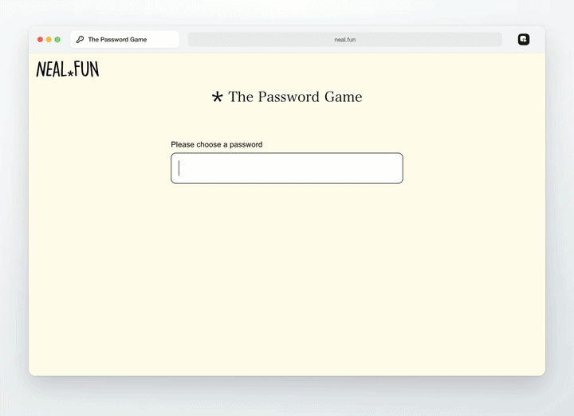
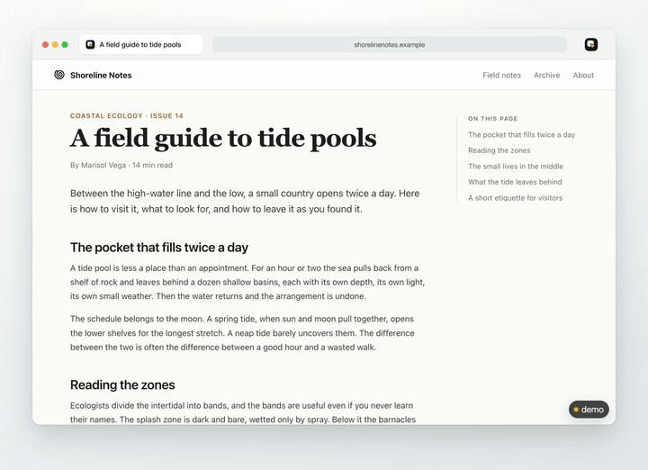
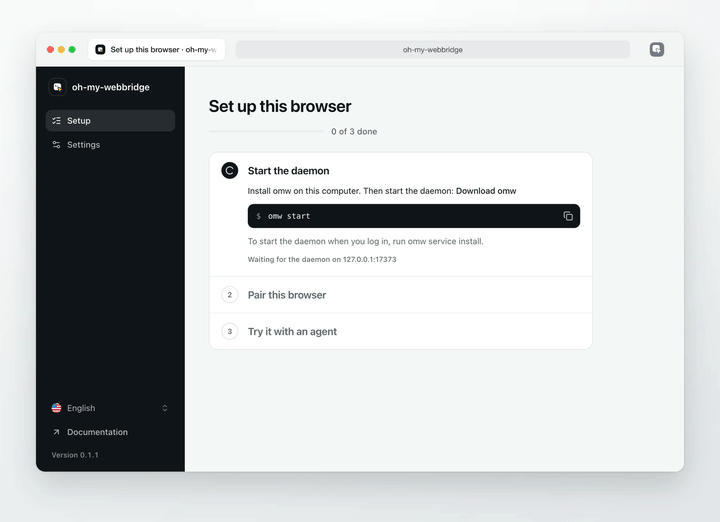
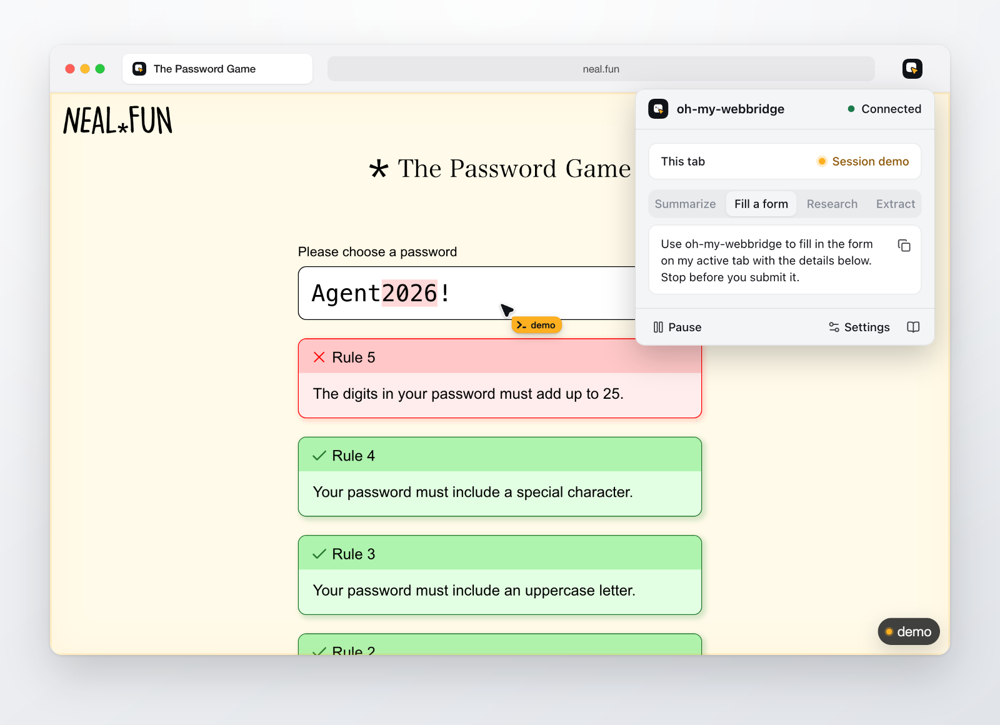
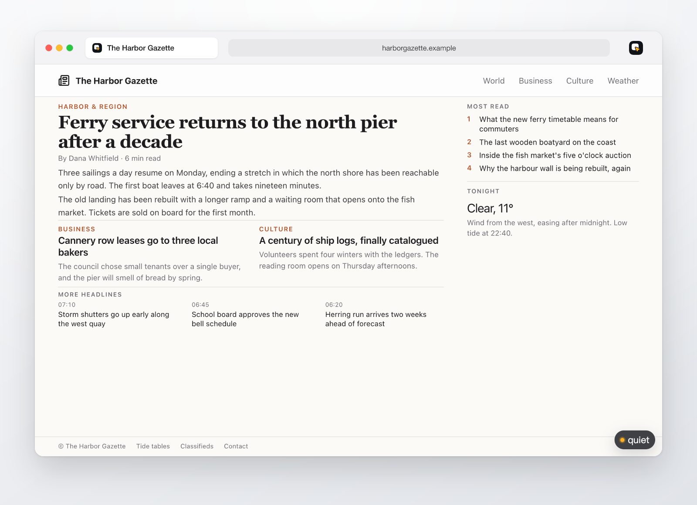

<picture>
  <source media="(prefers-color-scheme: dark)" srcset="packages/brand/icons/wordmark-dark.svg">
  
</picture>

# oh-my-webbridge

  

A local daemon and a browser extension that let an agent work in the Chrome or Firefox you already use, with your logins.

**[Documentation](https://oh-my-webbridge.github.io/en/)** · [繁體中文](https://oh-my-webbridge.github.io/zh-tw/) · [简体中文](https://oh-my-webbridge.github.io/zh-cn/)

> [!WARNING]
> **Developer preview**
>
> omw is in developer preview and iterating rapidly. **THERE WILL BE COMPATIBILITY-BREAKING CHANGES.**

  

<table>
  <tr>
    <td width="50%" valign="top">
      
      
An agent reads a long article. The focus frame marks each section it scrolls to.

    </td>
    <td width="50%" valign="top">
      
      
First run: the setup page finds the daemon and takes the code from <code>omw pair</code>.

    </td>
  </tr>
  <tr>
    <td width="50%" valign="top">
      
      
The popup names the session that controls the active tab.

    </td>
    <td width="50%" valign="top">
      
      
Task tabs block ads and trackers with the built-in <code>anti-ad</code> preset.

    </td>
  </tr>
</table>

## Install

1. Download the daemon and the extension from [Releases](https://github.com/oh-my-webbridge/oh-my-webbridge/releases/latest).
2. Load the extension in Chrome or Firefox. Its setup page shows the `omw start` and `omw pair` steps.
3. Install the agent skill with `omw install-skill ~/.agents/skills`, then give your agent a browser task.

[Getting started](https://oh-my-webbridge.github.io/en/getting-started/) covers each step and building from source. Scripts can use `omw call` or the [JavaScript SDK](https://oh-my-webbridge.github.io/en/reference/sdk/).

## Development

The repository layout, test suites and release process are in [Development](https://oh-my-webbridge.github.io/en/development/).

## License

[Apache License 2.0](LICENSE). Bundled third-party components are listed in [THIRD_PARTY.md](THIRD_PARTY.md).
